# Install and your first worktree

This takes you from nothing to the same store running twice on one machine, each copy on its own
branches, its own ports and its own `.env`. I use two repos throughout: `store-front`, a React app
on Vite, and `store-api`, a FastAPI service with a background worker. Your own repos work the same
way.

Apart from installing crew and opening its page, all of it happens in the browser, on crew's page.

## Before you start

crew runs on macOS and Linux. It needs git, because every project and every worktree is a git
checkout, and tmux, because dev servers and setup run in tmux sessions. Claude Code is what each
worktree's session runs, and what Voice OS and Setup with Claude use.

If your projects use mise, it has to be activated in your shell. That one bit me, so it gets its
own paragraph. crew runs a checkout's install through mise, so the install always finds the right
node or python. Dev servers run in your normal login shell though, and if mise isn't activated
there, `npm run dev` or `uv run` simply isn't on the PATH. The server dies with
`command not found` (you'll see exactly that [further down](#when-something-fails)). This is the
one thing the page can't do for you, so add it to your shell once:

```bash
echo 'eval "$(mise activate zsh)"' >> ~/.zshrc   # or bash, fish
```

## Install crew

```bash
curl -fsSL https://raw.githubusercontent.com/FurlanLuka/crew/main/install.sh | sh
```

## Open the page

```bash
crew
```

That starts crew's server if it isn't running and opens its page in the browser. Over SSH it
prints the link instead. The first time, the page opens on the first run with three ways in:
**Import** (an export from another machine), **Set it up step by step** and **Skip**.

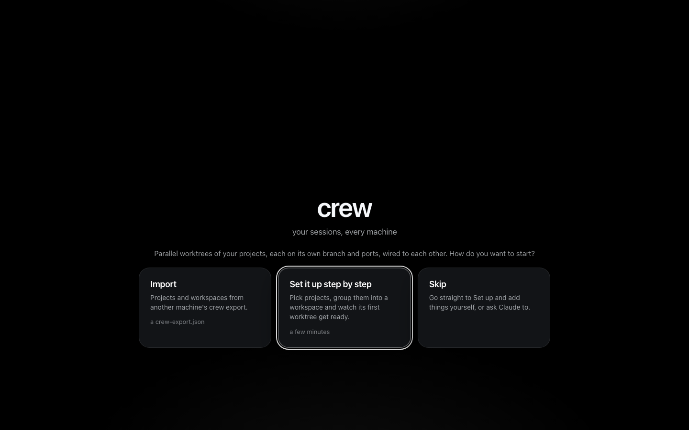

I pick **Set it up step by step**.

## Add the projects

The first step, **Pick your projects**, lists the git checkouts crew found in your usual code
folders (`~/code`, `~/projects`, `~/dev`, `~/src`, `~/Developer`, `~/work`, `~/repos`). Each one
you tick is cloned fresh from its remote into crew's own folder, `~/.crew/projects/<name>`. Your
checkout is never touched. That matters later: crew's worktrees branch from its own clone, so
nothing it does lands in the repo you already work in.

My two repos aren't on this machine yet, so I press **Add by URL**, paste the git URL and press
**Add store-front**, then the same for store-api:

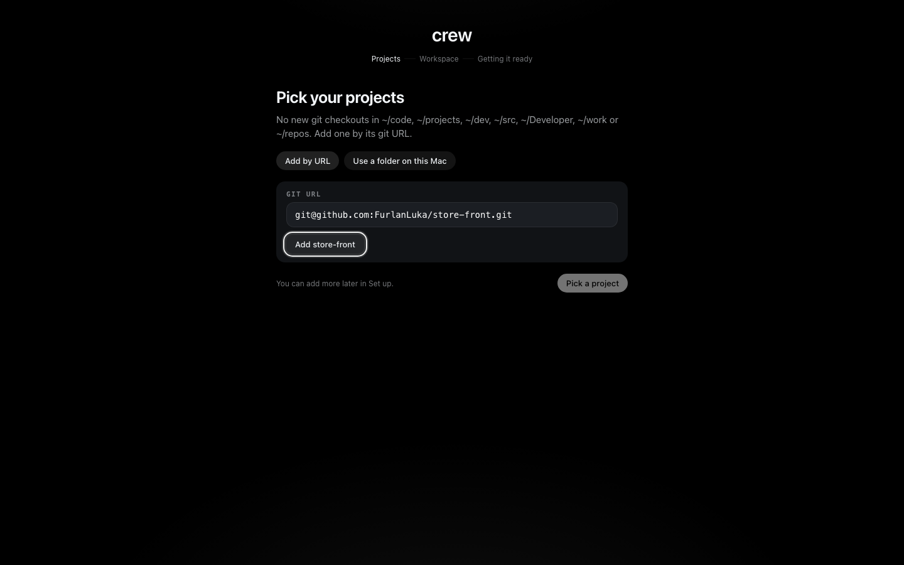

**Use a folder on this Mac** is there for a repo with no remote. crew then uses that folder as it
is, and its worktrees branch from your checkout.

From here on the git remote is the project's identity. crew also works out how to install every
new checkout: it found a `mise.toml` and a `package-lock.json` in store-front, so that's
`mise install` then `npm ci`, and for store-api it reads `uv.lock` and runs `uv sync`. The
lockfiles it knows are `uv.lock`, `pnpm-lock.yaml`, `yarn.lock`, `bun.lock` and
`package-lock.json`. When that isn't enough, you type your own install on the project's form later.

## Make the workspace

A workspace is the set of projects you work on together. The next step, **Make a workspace**, asks
for a name and the projects, and shows the session it will make. I call it `store`, keep both
ticked and press **Create store**:

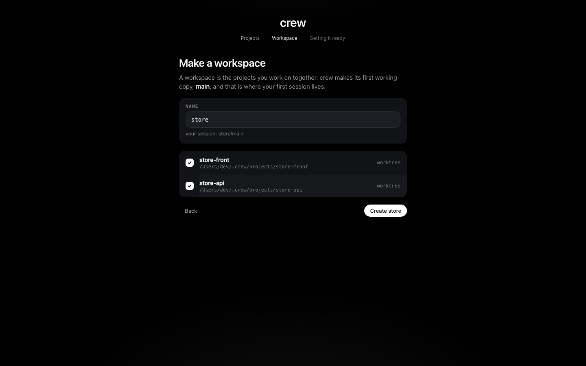

Creating it also makes its first worktree, `main`. For each project crew makes a git worktree on
its own branch (`crew/store/main/store-front`), copies the `.env` in and runs the install. Each
project gets its own runner in the background, so the slowest project sets the pace. **Getting
store/main ready** follows them, one row per project with the step it's on, and moves on by itself:

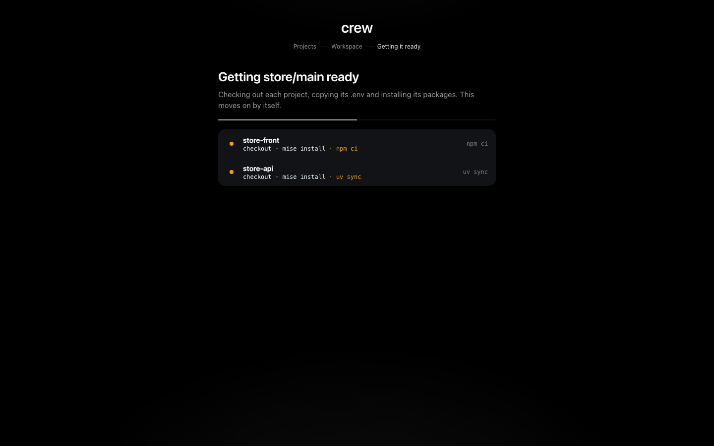

When both are done the first run says so:

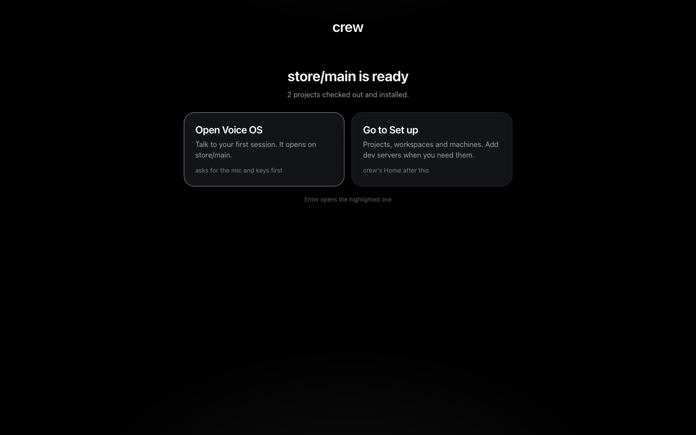

**Open Voice OS** is [tutorial 2](2-voice-os.md). There's nothing to run yet though, because crew
doesn't know how either project starts. So I press **Go to Set up**.

## Tell crew how each project runs

Set up opens on the board. The **Projects** tab lists both projects, and a click on one opens its
page with what crew recorded about it. **Edit setup** opens its form. That form has three parts:
the install and env command, the dev servers, and the Environment.

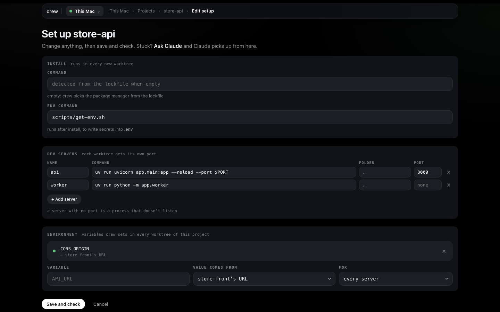

I start with store-front, because the Environment's **Value comes from** only offers projects that
already have a server with a port, and each project points at the other.

### Dev servers

A dev server is a name, a command, the folder it runs in and a port. **+ Add server** adds a row.
The one rule crew has for your code is that the command listens on `$PORT`. crew gives every
server in every worktree its own port and runs the command with `PORT` set to it, so two copies
never fight over 5173. The port you type is only a reference.

For store-front that's `web`, `npm run dev`, port `5173`. Its `vite.config.ts` reads the port from
`process.env.PORT`, so plain `npm run dev` is enough. Yours might need `-p $PORT` on the command.
**Save and check** saves it.

store-api has two. `api` is `uv run uvicorn app.main:app --reload --port $PORT` on 8000. `worker`
is `uv run python -m app.worker`, a process that pulls jobs and never listens on anything, so I
leave its port empty. A server with no port runs with no `PORT` and gets no URL, and when crew
checks it, staying alive is the whole test. If I'd given it a port, crew would wait a minute for
something to answer there and report it as not listening.

### The env command

store-api reads its secrets from `.env`. At work that file would come out of a vault or sops; in
this repo `scripts/get-env.sh` writes it, standing in for that. The **Env command** field runs in
every new checkout right after the install.

It has to write files and never print values, because its output goes into the install log. By the
time it runs, crew has already copied the `.env` from the project's own clone (or a sibling
worktree), so the env command only overwrites what it needs to.

### The Environment

The front needs the API's URL, and that URL is different in every worktree. A line in the
Environment says how to compute it, once, on the project that needs the value. On store-api I set
**Variable** to `CORS_ORIGIN`, **Value comes from** to **store-front's URL** and leave **For** on
**every server**. Before I save, the line shows what it would be in every worktree:

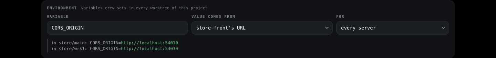

(That shot is from later, once `store/wrk1` existed. Before a worktree has the project, there's
nothing to preview.)

Then back on store-front's form, `VITE_API_URL` comes from **store-api api's URL**. It names the
server because store-api has two. When the servers start, that becomes
`http://localhost:<the port api got in that worktree>`. **Value comes from** also offers a
project's port, the worktree's or workspace's name and a fixed value.
[How crew works](../concepts.md#bindings) has the whole list.

### Save and check

**Save and check** records the form and then checks the project from nothing: a clean scratch
checkout, the install, the env command, and every dev server has to come up. The page follows it
step by step. It touches none of your worktrees, and a pass clears the scratch checkout away.

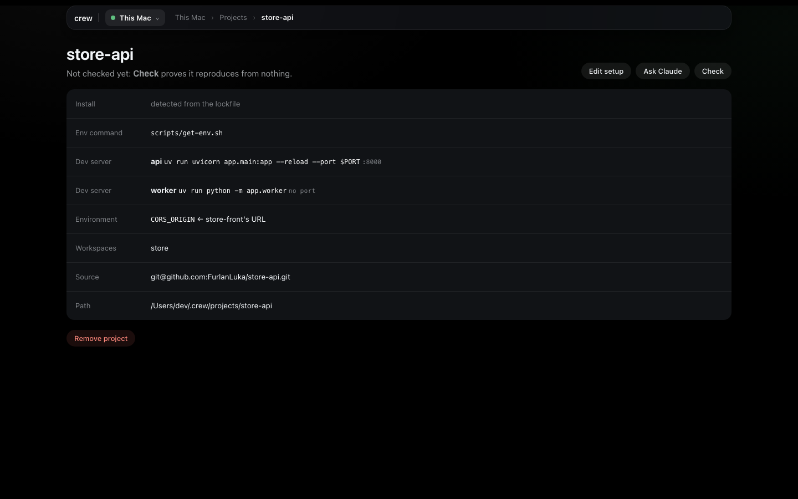

If you'd rather not fill the form yourself, **Ask Claude** hands the project to Setup with Claude,
which reads the repo, works out the servers and records them.

## Run it

Now the worktree. From the board's **Workspaces** tab I click the `main` chip on the `store` row.
The worktree's page has a **Dev servers** card with everything about its servers. Because I added
the servers after `main` was made, I press **Verify** first: it starts each server from scratch and
turns its line green as it answers. Then **Start**.

The card's top line says what's going on, "Running · 3 of 3 listening" here, with **Stop**,
**Restart** and **Verify**. Each server shows its command, and the two that listen show their URL.
The worker has no URL, only the word that it answered.


Under it, the **Environment** card. **What each server gets** opens the final env, project by
project. Click a server and its log opens beside the list and follows it. Logs start fresh on
every start.

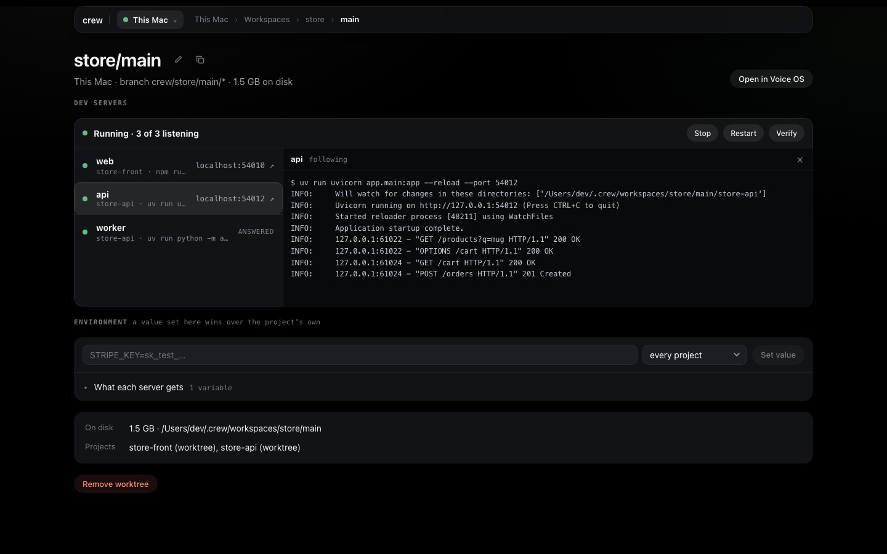

## A second worktree

This is the point of all of it: a second copy of the whole store, on its own branches, running at
the same time. On the board, **+ new** on the `store` row opens **New worktree in store**:

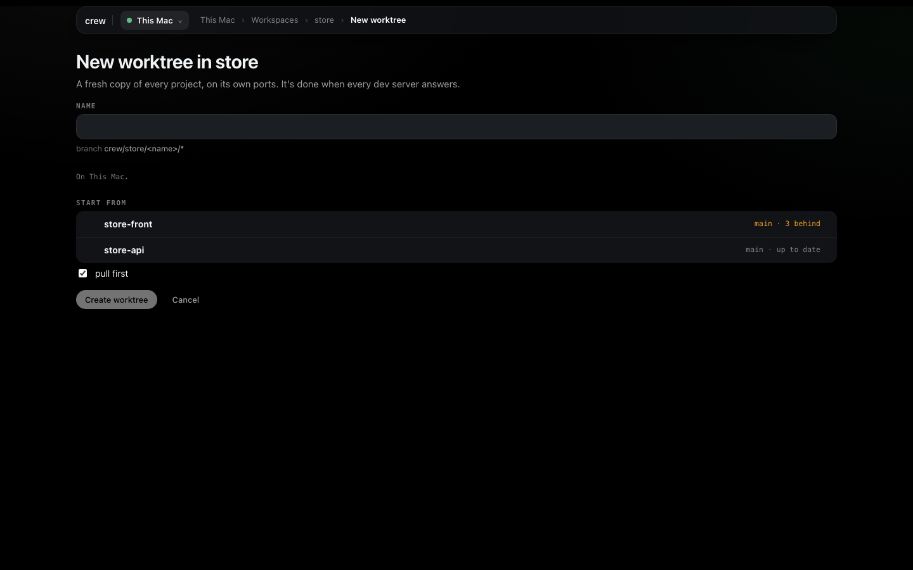

**Start from** shows each project's base branch and how far it is behind origin, and **pull
first** fast-forwards those bases before branching. I name it `wrk1` and press **Create worktree**.
That takes me to `store/wrk1`'s page, where the Dev servers card follows each project through
checkout, install, env command and its servers coming up. When it's done I press **Start** there
too.

Both copies now run side by side, each on ports of its own. Each one talks to its own API, because
`VITE_API_URL` resolved against that worktree's ports: open **What each server gets** on either
page and you'll see it. A worktree keeps its ports, so a restart lands on the same ones. Now one
Claude can fix search in `wrk1` while `main` stays as it was.

## When something fails

Making a worktree never stops halfway. A step that fails is recorded on the worktree with its
evidence, and the other projects carry on. My first try was before mise was active in my shell.
The install worked, because it ran through mise, but `web` died: the Dev servers card showed it in
red and opened its log by itself, ending in `zsh: command not found: npm`.

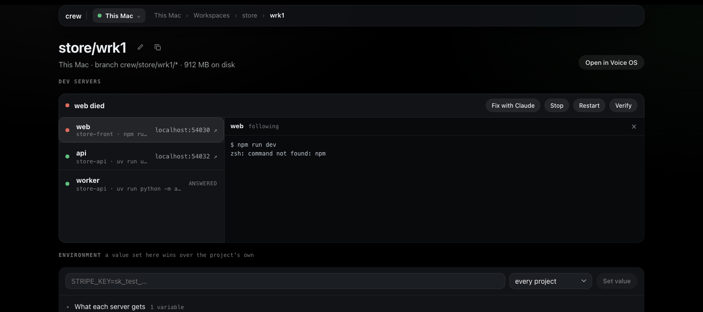

The board shows it too, in the problems strip at the top, one row per thing that needs you, with
**Fix** (the page with the failure on it) and **Fix with Claude**. It stays there until something
clears it.

There are two ways out. **Fix with Claude** hands the failure, with its log lines, to Setup with
Claude, and the worktree's Dev servers card opens beside the chat so I can watch its servers stop,
restart and answer while Claude works. Or I fix it myself (here, the shell line [above](#before-you-start)) and press **Verify**,
which starts each server from scratch and clears the failure once every one answers. A failed
install shows **Install again** instead. Verify stops running servers first, and asks before it
does.

## Next

[Tutorial 2](2-voice-os.md) opens Voice OS on these worktrees and fixes the search bug by talking
to them. [Set up](../guides/setup.md) has every page in detail, and
[how crew works](../concepts.md) the model underneath. Every button here is also a crew command,
listed in [the command reference](../commands.md).
