# 2. Working with Voice OS

In [the first tutorial](1-install-and-first-worktree.md) you made the `store` workspace with
store-front and store-api, checked out `store/main` and then
[a second worktree](1-install-and-first-worktree.md#a-second-worktree), `store/wrk1`. Both run
their dev servers on their own ports. This one is about the other half of crew's page, Voice OS,
where each of those worktrees gets its own Claude Code session and you drive them by talking,
typing or clicking. We'll fix a real bug in store-api along the way. Your own repos work the same
way.

Everything here is covered in more depth in [the Voice OS guide](../guides/voice-os.md), and every
single thing you can say is listed in [Voice OS commands](../guides/voice-os-commands.md).

## Two keys

Voice OS needs two API keys of its own. The Anthropic key runs the kernel, the small model that
works out which session your words are for, and the narrator that writes the spoken summaries.
It is separate from your Claude Code login, which is what the sessions themselves run on. The
Soniox key is speech in and out. Get the first from the
[Anthropic Console](https://console.anthropic.com) and the second from your Soniox account at
[soniox.com](https://soniox.com). Both bill per use; the guide's
[Privacy and cost](../guides/voice-os.md#privacy-and-cost) has the numbers.

You don't have to set them up front. The first time you open Voice OS without them, the page shows
a **Before you talk** sheet that asks for the microphone and for each missing key. crew checks
each key with its service before saving it, and a rejected one stays in red with the reason. Press
**Start Voice OS** when they're in, or **Not now** if you only want to type for a while: text and
clicks work without them.

If you'd rather do it from a terminal, pipe each key in:

```bash
pbpaste | crew server keys set anthropic
pbpaste | crew server keys set soniox
crew server keys
```

The last one shows which keys are set and where (`~/.config/crew-voiceos/`, readable by you
only), never their values. A key saved while the server runs is used from your next words on, no
restart. Don't export `ANTHROPIC_API_KEY` in your shell instead: it would also move your own
Claude Code onto per-token billing.

## Opening Voice OS and activating the worktrees

Run `crew` and the page opens on **Home**. Pick **Voice OS**.

Nothing talks yet, because only **active** sessions exist for voice. An inactive worktree has no
Claude process and says nothing; activating one starts its Claude Code session in that worktree,
with crew's orientation prompt, and gives it a tab. Open **New → Activate a worktree** (or the same
button on Home). That page lists every worktree on the machine grouped by workspace, and each row
has **Activate**. Activate `store/main` and `store/wrk1`.

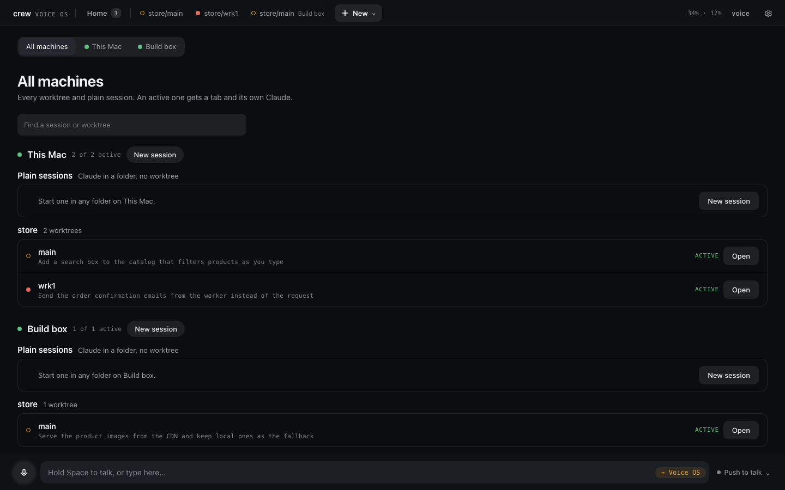

You can also just say it: "Activate store main." Voice OS answers "Activated store/main. Switch
there?", and a yes takes you there. From the button nothing is said.

## Home

Voice OS opens on Home from now on. On the left is one row per active session, from every machine,
each with what it is doing. Whatever waits on you comes first, tinted, with **Answer**. On the
right is a card per machine with what it holds.

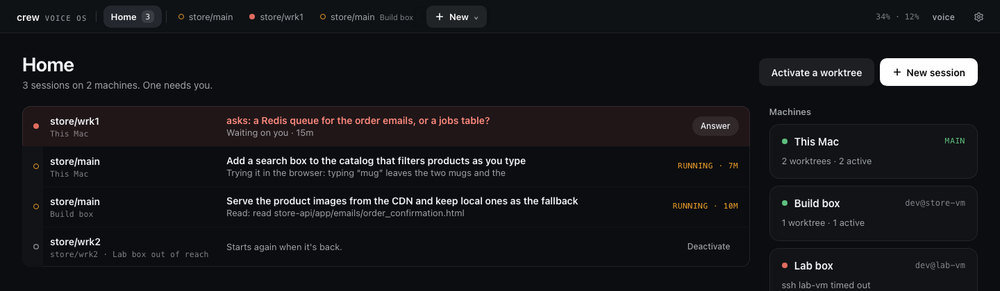

The bar along the top has a tab for each active session with a state dot. Drag a tab to reorder it
(Home's list follows the bar's order). Drop a tab onto the middle of another tab instead and the two
become a **group**: an outline shows you're about to group rather than move, and you're asked for a
name. When both sessions are in one workspace it suggests that workspace's name, so here it offers
`store`. Each group gets its own colour (blue, violet, pink, teal, sand or slate, the first one not
already taken), and you can change it from the group's right-click menu, where you also rename or
ungroup it. On the bar a group is one chip with its sessions' dots and a count; click it and the
bar holds only that group until you press **‹** or Esc.

Home shows one list per group, in its colour and in the bar's order, with the sessions in no group
last.

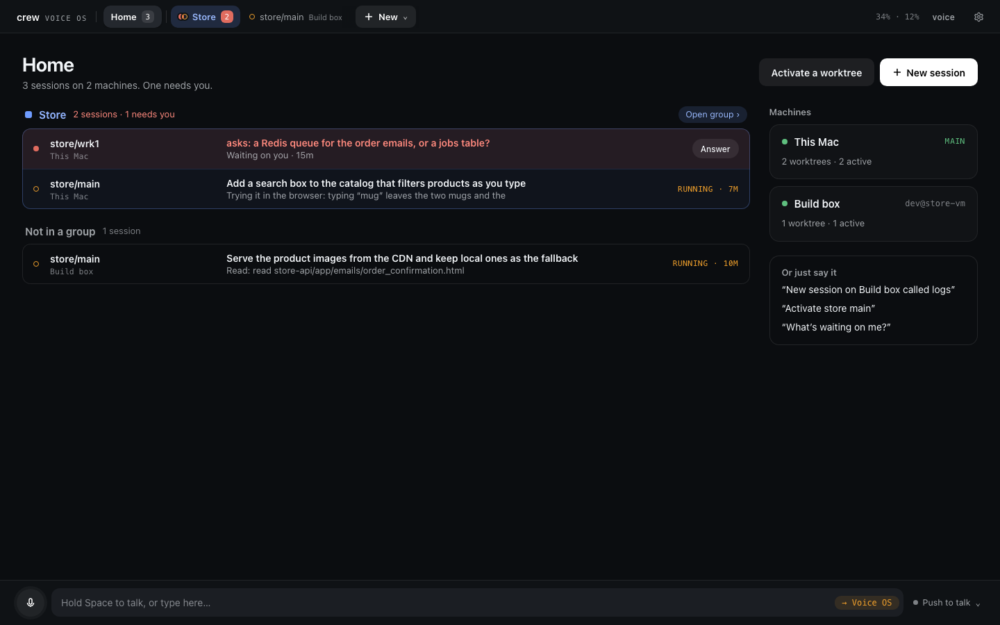

Groups are a page thing only. Voice doesn't know about them, so you still talk to sessions by name.

## Giving a session a name

`store/wrk1` is fine to read but clumsy to say. Click **rename** on a session's header, type a name
and press Enter, or say "rename this to search work". The name replaces the ref everywhere on the
page and in what Voice OS says, and it answers to it. Names are Voice OS's own and change nothing in
crew or git; an empty name brings the ref back. I'll keep `store/main` as it is for the rest of this.

## How the tab listens

The round button next to the mic chooses how this tab listens.

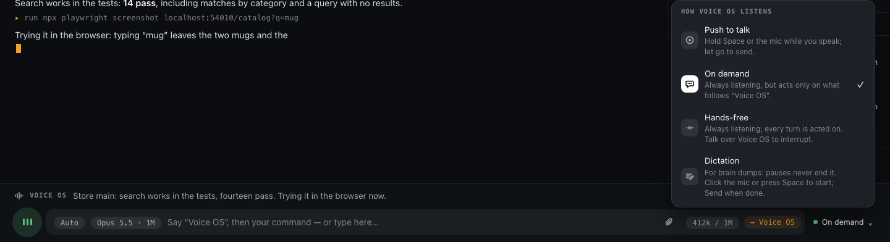

**Push to talk** is the default and the one I use most: hold Space (outside a text field) or the
mic button, talk, let go. **Hands-free** listens all the time and every sentence is a turn, which
is nice when your hands are busy and costs more, since the microphone streams to Soniox the whole
time. **On demand** also listens all the time but acts only on what follows "Voice OS", for a noisy
room. **Dictation** is for long brain dumps that go to the session word for word. Each tab remembers
its own mode, and "hands-free on" or "push to talk" by voice switches it too.

You can always type. Text typed on a session page goes straight to that session, as if you typed
it into Claude Code.

## Fixing the search bug

Here is the bug. On store-front, searching for "Mug" finds both mugs, and "mug" finds nothing.
Open `store/main`, hold Space, and say:

> Find out why searching for mug shows nothing.

The words go to `store/main` exactly as you said them. The session knows it is in a crew worktree,
so it reads the API's log through crew rather than guessing:

```bash
crew dev logs store/main api --lines=50
```

and finds the line `search q='mug' -> 0 products` next to `q='Mug' -> 2 products`. From there it
opens `app/catalog.py` in store-api, where `search` compares `query in product.name`, which is case
sensitive, and proposes to compare both sides lowercased. It speaks a short line when it has
something to say, and the stream shows the diff.

Sessions start in **Auto** mode, so reading files and running the tests through
`crew run store/main store-api -- uv run pytest -q` go ahead on their own. When it wants something
Claude Code judges risky, or when you've put it in Ask mode, it asks.

### Questions and approvals

When a session asks you something, it is docked above the text box as a card: a title that asks,
what you're judging, and the answers on the right. A dim line under it says what to say.

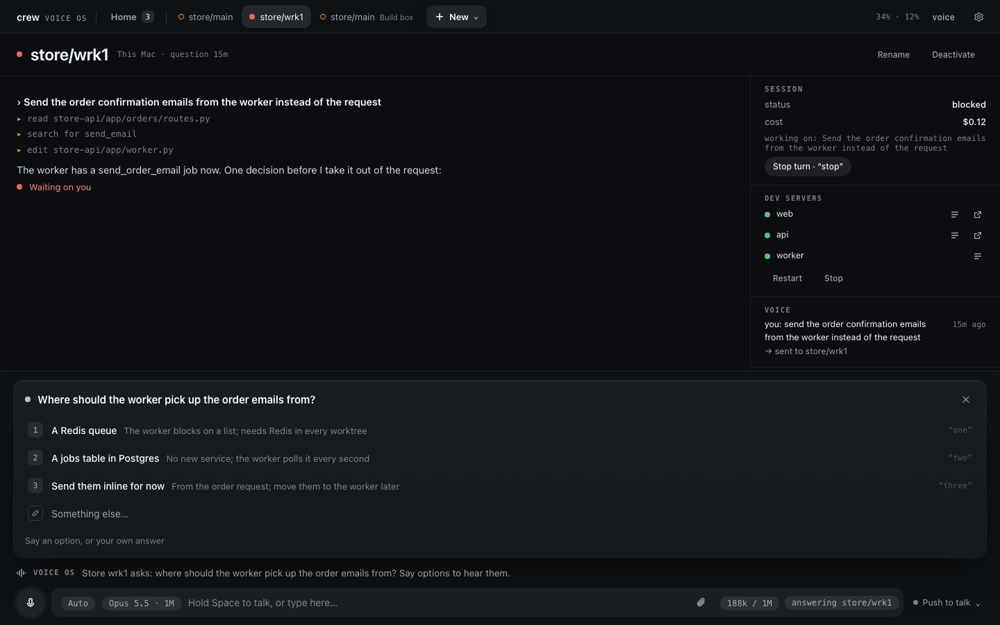

Answer it the way you'd answer a person: "the second one", "yes", "no, keep the exact match for
SKUs". A question waiting on another session shows on Home first, tinted, with **Answer**.

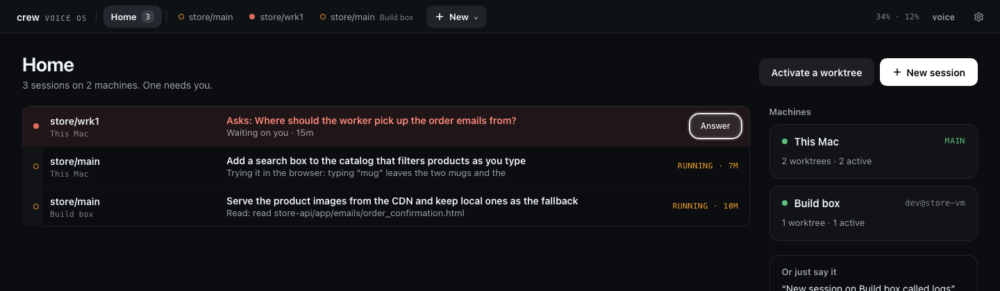

A permission reads the same way: what it wants to run, why, and **Allow**, **Deny** or **Deny and
say why…** (plus **Always allow …** when Claude Code suggests a rule).

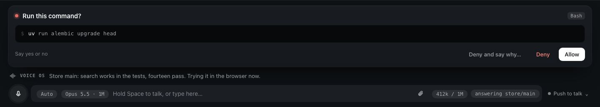

In Auto mode, a call Claude Code blocks comes as a card with a red dot. **Allow once** (or "allow
it") lets that one call through and auto mode is back for the next one; **Leave it blocked** lets
the session carry on without it.

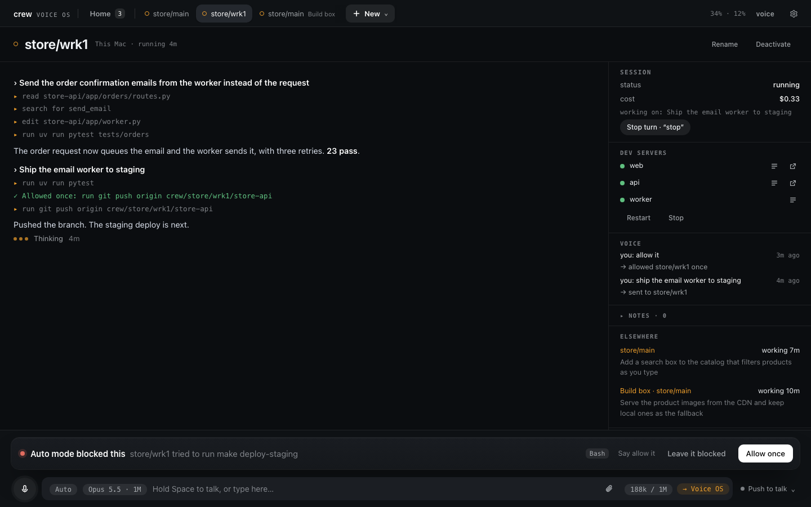

For the fix, say "yes, go ahead" when it asks to apply the change. Then try "mug" on store-front's
URL: both mugs show up. That's the whole loop, and you never left the page.

### Which session your words go to

Words go to the session on your screen, or to a session you name. Voice OS never guesses. If you're
on `store/main` and say "store work one, run the tests", the words go to `store/wrk1`, you stay where
you are, and you hear "Sent to store/wrk1. Switch there?". If your words only mention another
session ("put this on top of the wrk1 branch"), it asks "For store/wrk1?": yes sends them there, no
or silence keeps them on the session on screen. A follow-up that names nobody stays on screen too,
whatever you heard last. Updates from sessions you're not looking at wait for a quiet moment and
come as one "Meanwhile…" line.

## Modes, model and context

Left of the text box are two chips, and right of it a meter.

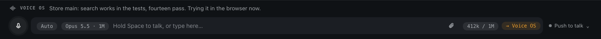

The first chip is the session's permission mode. **Auto** is the default: routine work runs and
Claude Code's classifier blocks what looks risky. **Plan** plans and changes nothing; approving the
plan puts it back in the mode it had. **Ask** brings every permission to you as a card, like Claude
Code in a terminal. **Skip permissions** runs everything unchecked, and said aloud ("skip
permissions for store main") Voice OS asks first. Pick one from the chip, type `/mode plan`, or say
"switch to plan mode". The mode sticks per session, across restarts. Questions and plans come to
you in every mode.

The second chip is the model ("Opus 5.5 · 1M"). Tap it to pick Opus, Sonnet or Haiku for the next
turn, the same as `/model`.

The meter says how full the context is ("42k / 200k"). It turns amber as Claude Code nears
compacting on its own and red just before it does. Tap it for **Compact** or **Clear**; both ask you
to confirm first.

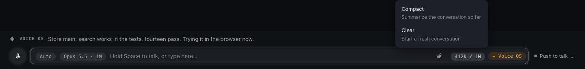

## Attachments

To hand a session a screenshot or a log, paste it, drop it on the page or use the paperclip. Each
file becomes a chip above the box and goes with your next words to that session, typed or spoken.
Up to 20 MB each, ten at a time; a session on another machine gets its own copy.

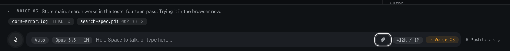

## Notes and debug notes

Say "note: search should ignore accents too" and Voice OS replies "Noted.", saving it to the
workspace on screen, `store` here. "What are my notes?" reads them back, and from a terminal:

```bash
crew server notes store
```

A **debug note** is for when Voice OS itself gets something wrong: it misheard, sent words to the
wrong session, talked at a bad moment. Say "debug note: it sent that to wrk1 when I was on main"
right away. It saves a snapshot of the moment, and `crew server debug-notes` lists them
(`crew server debug-notes show 3` prints one with the log around it). Include them if you report a
bug.

## Plain sessions

Not everything is a worktree. **New → New session** opens a dialog: the machine, a folder (home when
you name none) and a name. It starts a plain Claude conversation there, no crew instructions and no
dev servers, active at once. Saying "start a new session called research in my notes folder" does
the same, and so does `crew chat add --dir=~/notes --name=research`. **Remove** on its page, or
"remove research", drops it and leaves the folder alone.

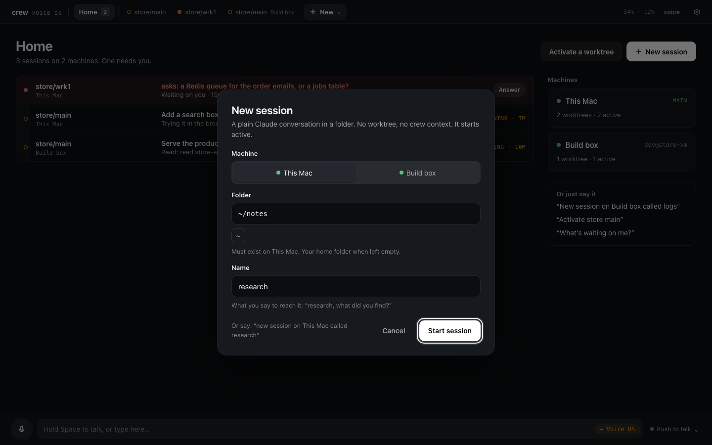

## Sessions asking each other

Sessions can reach each other too. Tell `store/wrk1` "ask store main how it fixed the search" and
it asks: a read-only copy of `store/main` answers from what that session knows and its files,
without interrupting it. If the answer needs real work (running the tests, say), you're asked to
**Allow** it first, and a session asking for a secret always asks you. Each request is a card in the
asking session's stream, with where it stands and what came back.

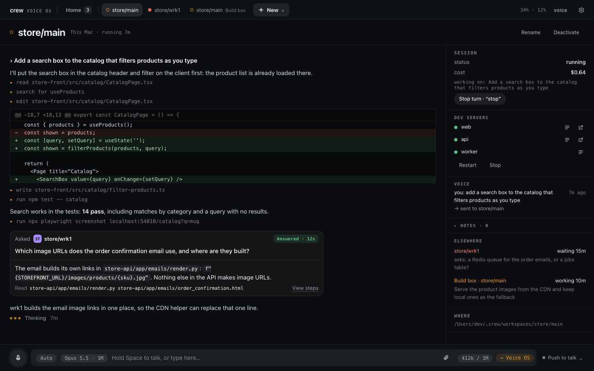

## Voice off and the phone

**voice** in the top bar, by the settings gear, turns all listening and speaking off in one click,
for a call or a quiet office. It shows struck through; click it again to come back. Typing works
the whole time, and nothing from the quiet time is read out later.

On a phone the page fits the width, with the tabs scrolling sideways. Browsers give the microphone
only to `localhost` or HTTPS, so on a phone open the proxy link `crew` prints, after
`crew dev proxy trust` has shown you how to trust crew's certificate on that phone. Until then the
link works for text and clicks.


## Next

That's a day's work by voice on one machine. [Tutorial 3](3-remote-machine.md) adds a second one, a
build box over SSH, whose sessions show up on the same page next to these.
