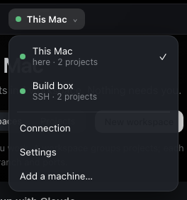
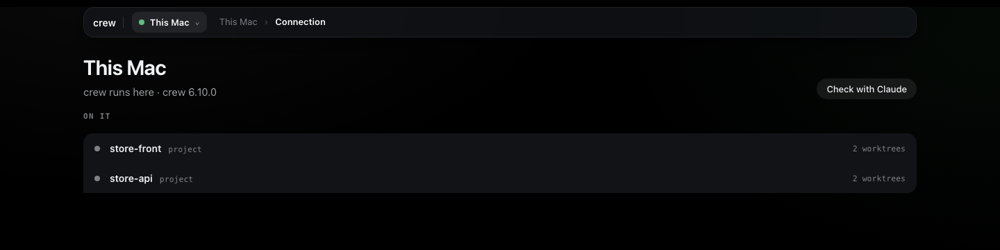
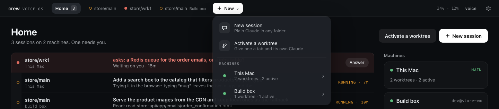
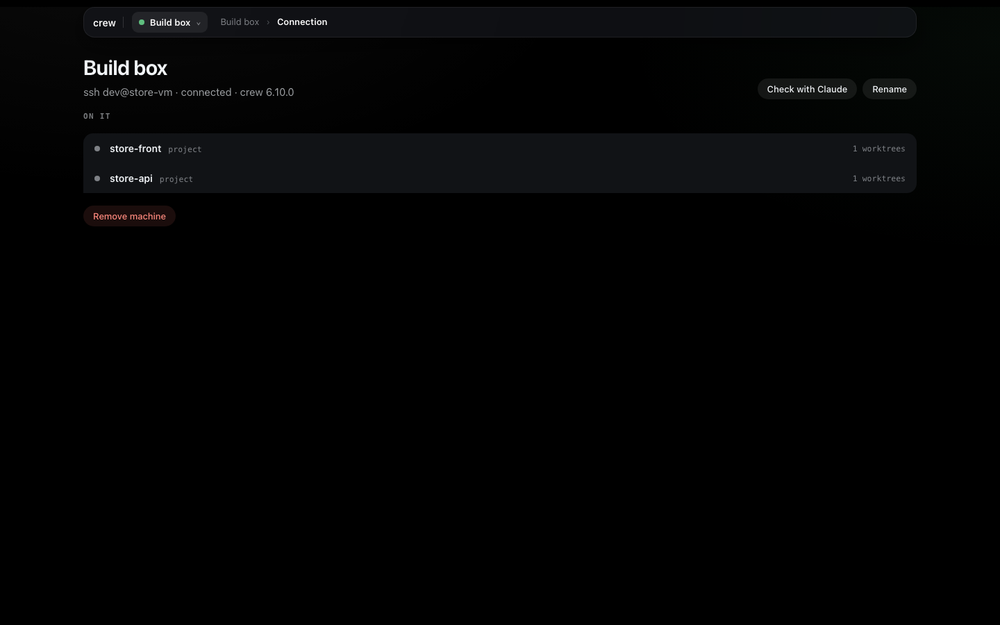

# A remote machine

So far everything ran on one computer. This tutorial adds a second one, a Linux VM I call the
Build box, reached as `dev@store-vm`. Once it's added, the crew on my laptop (the **main**) drives
it: I set up the store there from my laptop's Set up page, its Claude Code sessions show up in
Voice OS next to the local ones, and I talk to them the same way. The VM itself runs no page, no
keys and no voice. It only runs the sessions and the dev servers.

Any machine you can SSH into works, a cloud VM, a box under your desk or a second laptop. It
assumes you went through [the first tutorial](1-install-and-first-worktree.md) and
[the second](2-voice-os.md) on the main. The reference for all of this is
[Machines](../guides/setup.md#machines) in the Set up guide and
[Other machines](../guides/voice-os.md#other-machines) in the Voice OS guide.

Most of this happens on the page. The terminal part is getting SSH right and installing crew on
the VM, because the page can't reach a machine before both are done.

## What the VM needs

- Linux or macOS, x64 or arm64.
- SSH access from the main with a key, never a password.
- crew, which brings git and tmux with it.
- Claude Code, signed in. The sessions run on that machine's Claude Code login.
- Access to your git host, so crew can clone the projects there.

## SSH without prompts

The main reaches the VM by running plain `ssh` in the background, with no terminal behind it, so
nothing may ask a question: no password, no key passphrase, no "are you sure you want to continue
connecting". If `ssh store-vm true` works in your terminal without you typing anything, crew will
connect too.

On the laptop, make a key for the VM if you don't have one, and copy it over:

```bash
ssh-keygen -t ed25519 -f ~/.ssh/store_vm
ssh-copy-id -i ~/.ssh/store_vm.pub dev@<the VM's address>
```

Cloud providers often want the public key in their console or instance metadata instead of
`ssh-copy-id`. Either way it ends up in `~/.ssh/authorized_keys` on the VM. Then give the VM an
alias in `~/.ssh/config`, so you and crew both just say `store-vm`:

```
Host store-vm
  HostName <the VM's address>
  User dev
  IdentityFile ~/.ssh/store_vm
```

Now test it the way crew will. The first `ssh` accepts the host key. The second must print nothing
and come back at once:

```bash
ssh store-vm
ssh -o BatchMode=yes store-vm true
```

If your key has a passphrase, load it into the agent (`ssh-add ~/.ssh/store_vm`) so it never asks.
A VM behind a tunnel, like a Google Cloud VM reached through IAP, works with a `ProxyCommand` line
in the same `Host` block. Write the full path to the tool there (`command -v gcloud` prints it),
because crew's server runs in tmux and its `PATH` may not be your shell's.

## Install crew on the VM

SSH in and install crew, then the tools it needs:

```bash
ssh store-vm
curl -fsSL https://raw.githubusercontent.com/FurlanLuka/crew/main/install.sh | sh
echo 'export PATH="$HOME/.local/bin:$PATH"' >> ~/.bashrc && source ~/.bashrc
crew doctor --install
```

`crew doctor --install` shows each install command (apt-get, dnf or pacman) and asks before it
runs it. It asks about Claude Code separately, say yes. Then run `claude` once and sign in.

The VM also needs its own access to your repos, because crew clones them there. My projects use
`git@github.com:` remotes, so I give the VM a key of its own and add it to GitHub (Settings → SSH
and GPG keys, or a deploy key per repo if you'd rather keep it narrow):

```bash
ssh-keygen -t ed25519
cat ~/.ssh/id_ed25519.pub     # paste this into GitHub
ssh -T git@github.com         # says hello with your user name
```

If you use mise, activate it in the VM's shell too, same as on the laptop
(`echo 'eval "$(mise activate bash)"' >> ~/.bashrc`). crew runs installs through mise itself, but
the dev servers run in your normal shell.

Last, while you're still on the VM, run `crew server remote`. It checks tmux and Claude Code,
downloads the matching Voice OS and starts the part of crew that the main talks to. The main would
do the same over SSH when it connects, but running it once by hand tells you right away if
something is missing. That's the end of the terminal. Everything from here is on the laptop's page.

## Add it on the main

Back on the laptop, open crew's page and go to **Set up**. The machine picker is the button at the
top left with **This Mac** in it. Open it and pick **Add a machine…** at the bottom.



Fill in the **SSH address** (`store-vm`, or `dev@store-vm`) and a **Name**. The name is what you
call it, out loud too, so I pick something I'd say: Build box.


**Connect without Claude** adds it straight away and takes you back to the board. **Connect with
Claude** hands the same job to Setup with Claude, which is handy when you're not sure the VM is
ready: if it doesn't connect, Claude reads the reason and tells you what to do about it.

Open the machine picker again and Build box is in it. A green dot means it's connected. While it
connects, or when something's wrong, the line under its name says why and it can't be picked yet.
[Troubleshooting](#troubleshooting) below has each of those messages.

## Set up the store there

There's nothing new to learn here. Every form in Set up works on the machine picked in the picker,
so pick **Build box** and do what you did in the first tutorial: **Add project** for store-front
and store-api by URL, their servers and bindings in **Edit setup**, and the `store` workspace. crew
clones into `~/.crew/projects` on the VM, with the VM's git access, and makes `store/main` there.

Each machine also has its own **Setup with Claude**. With Build box picked, the chat is a Claude
session on the VM, in its home folder, with the VM's crew. So "set up the store on this box and
start main" sets up the VM, not the laptop. This is how I usually do it.


If the laptop already has the store set up, you can move it across instead. With **This Mac**
picked, go to **Settings** in the machine picker and press **Export…** under Move to another
machine. Then pick **Build box**, open its **Settings** and press **Import…** with the file. The
file carries projects by their git remote, so the VM clones them itself.
[Moving to another machine](../guides/setup.md#moving-to-another-machine) walks through both pages.

**Connection** in the machine picker opens the machine's own page. It says how it's reached, which
crew it runs and each project on it with its worktree count. **Check with Claude** has that
machine's Claude look at the connection, tools, disk and projects, which is the first thing I press
when something on the VM feels off.



## Its sessions in Voice OS

Once the VM has worktrees, open Voice OS. Home gets a card for Build box, and the **New** menu in
the top bar has Build box under Machines.



Pick Build box there and you get its page: whether it's connected, **Open in Set up**, **New
session on Build box**, its plain sessions and its worktrees grouped by workspace. Press
**Activate** on `store/main` and it gets a tab like a local session, with Build box next to its
name. Once it's active the row says so and the button turns into **Open**.


Talking to it works the same as before. If the same worktree exists on both machines, the name means
the one on the machine you're looking at, and you name the machine to reach the other ("store main
on Build box, run the tests"). Its dev servers are the VM's own, so their links are the VM's
addresses. [The next tutorial](4-from-anywhere.md) is about reaching those.

When the link drops, the sessions on the VM keep working. The machine shows as out of reach, what
you say to it waits, and when it's back you hear one line about what happened meanwhile.

## Updates

You update the main and the main updates the VM. When a newer crew is out, **Settings** in Set up
(with This Mac picked) says so at the top with an **Update** button, and after it **Restart crew's
server**. The next time the main connects to the VM and sees it on an older crew, it updates it over
SSH, once per version, and reconnects. The machine's line says "Updating Build box…" while that
happens. Until it's done, anything the old crew can't run yet says it updates from this Mac. A
session that was working on the VM is cut off and resumes on the new release.

It never goes the other way. If the VM runs a newer crew than the main, the machine's line says so,
and the fix is to update the main the same way, **Update** and then **Restart crew's server**.
Restarting ends every running session on the main until they start again, so I do it when nothing
is mid-task.

## Rename or remove it

Pick Build box and open **Connection** in the machine picker. **Rename** is next to **Check with
Claude**, and **Remove machine** is at the bottom. Saying "rename store-vm to Build box" works too.



Removing a machine only stops the main driving it. The page asks first, and says so: its sessions,
worktrees and projects stay on the VM, and adding it back picks them up again.

## Troubleshooting

When a machine isn't connected, the reason shows under its name in Set up's machine picker, on its
**Connection** page, and in Voice OS's **Settings** under Machines, where **In Set up** takes you to
it. Here's each message and what fixes it. Most of these are on the VM, so they're a terminal
again.

| It says | Fix |
| --- | --- |
| Its host key is not trusted yet: run ssh store-vm once in a terminal. | Run `ssh store-vm` once and accept the key. |
| SSH refused the login: check your key or ssh-agent. | Check `IdentityFile` in `~/.ssh/config`, or `ssh-add` a key with a passphrase. |
| Host store-vm not found. | The alias isn't in `~/.ssh/config`, or the address doesn't resolve. If you typed it wrong, **Remove machine** and add it again. |
| crew is not installed there: install it, then run crew server remote. | Install crew on the VM as above. crew looks in your login `PATH` and in `~/.local/bin`. |
| Missing on that machine: tmux, claude. | Run `crew doctor --install` on the VM, then sign in to Claude Code there. |
| That machine runs Voice OS as a main, not as a remote. | Somebody ran bare `crew` there. Run `crew server stop` on it, then `crew server remote`. |
| Voice OS could not be installed there: … | The VM couldn't download Voice OS. Check its network, then run `crew server remote` there to see the error. |
| Its Voice OS did not start: run crew server remote there. | Run `crew server remote` on the VM and read what it says. |
| … runs Voice OS …, newer than this one …: run crew update here, then crew server restart. | Update the main from Settings, as in [Updates](#updates). |

Anything else shows SSH's own last line, usually a timeout. Run `ssh -o BatchMode=yes store-vm true`
yourself and fix whatever it complains about. Once the machine connects, **Check with Claude** on
its page is the quickest way to find out what else is wrong there.

Everything on these pages is also a crew command, listed in [every command](../commands.md).

Next: [From anywhere](4-from-anywhere.md), for crew's page on another computer or your phone, and
Voice OS in Discord.
