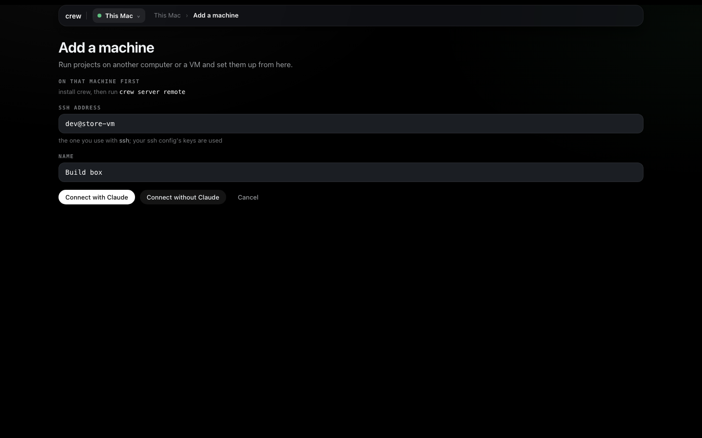
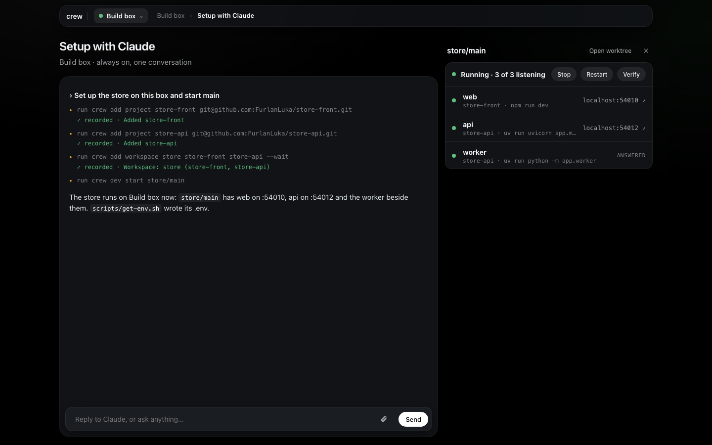
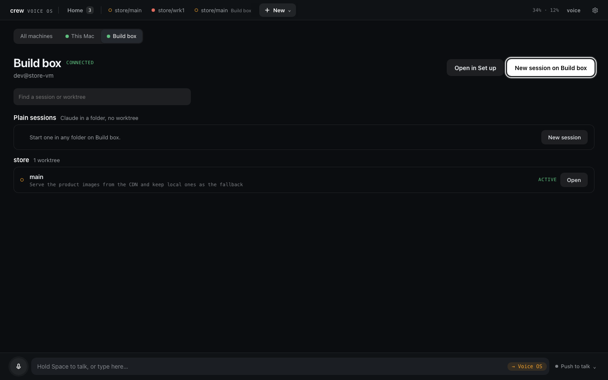

# A remote machine

So far everything ran on one computer. This tutorial adds a second one, a Linux VM I call the
Build box, reached as `dev@store-vm`. Once it's added, the crew on my laptop (the **main**) drives
it: I set up the store there from my laptop's Set up page, its Claude Code sessions show up in
Voice OS next to the local ones, and I talk to them the same way. The VM itself runs no page, no
keys and no voice. It only runs the sessions and the dev servers.

Any machine you can SSH into works, a cloud VM, a box under your desk or a second laptop. It
assumes you went through [the first tutorial](1-install-and-first-worktree.md) and
[the second](2-voice-os.md) on the main. The reference for all of this is
[Other machines](../guides/voice-os.md#other-machines) in the Voice OS guide.

## What the VM needs

- Linux or macOS, x64 or arm64.
- SSH access from the main with a key, never a password.
- crew, which brings git and tmux with it through `crew doctor --install`.
- Claude Code, signed in. The sessions run on that machine's Claude Code login.
- Access to your git host, so crew can clone the projects there.

## SSH without prompts

The main reaches the VM by running plain `ssh` in the background, with `BatchMode=yes` and a
10 second connect timeout. There's no terminal behind it, so nothing may ask a question: no
password, no key passphrase, no "are you sure you want to continue connecting". If `ssh store-vm
true` works in your terminal without you typing anything, crew will connect too.

On the laptop, make a key for the VM if you don't have one, and copy it over:

```bash
ssh-keygen -t ed25519 -f ~/.ssh/store_vm
ssh-copy-id -i ~/.ssh/store_vm.pub dev@<the VM's address>
```

Cloud providers often want the public key in their console or instance metadata instead of
`ssh-copy-id`; either way ends with the key in `~/.ssh/authorized_keys` on the VM. Then give the
VM an alias in `~/.ssh/config`, so you and crew both just say `store-vm`:

```
Host store-vm
  HostName <the VM's address>
  User dev
  IdentityFile ~/.ssh/store_vm
```

Now test it the way crew will. The first `ssh` accepts the host key; the second must print
nothing and come back at once:

```bash
ssh store-vm
ssh -o BatchMode=yes store-vm true
```

If your key has a passphrase, load it into the agent (`ssh-add ~/.ssh/store_vm`) so it never asks.
A VM behind a tunnel, like a Google Cloud VM reached through IAP, works with a `ProxyCommand` line
in the same `Host` block; write the full path to the tool (`command -v gcloud` prints it), because
crew's server runs in tmux and its `PATH` may not be your shell's.

You can use `dev@store-vm` or any `user@host` instead of an alias. I prefer the alias, because the
editor, `crew code` and crew all read the same entry.

## Install crew on the VM

SSH in and install crew, then the tools it needs:

```bash
ssh store-vm
curl -fsSL https://raw.githubusercontent.com/FurlanLuka/crew/main/install.sh | sh
echo 'export PATH="$HOME/.local/bin:$PATH"' >> ~/.bashrc && source ~/.bashrc
crew doctor --install
```

`crew doctor --install` shows each install command (apt-get, dnf or pacman) and asks before it
runs it; Claude Code is asked about separately, say yes. Then run `claude` once and sign in.

The VM also needs its own access to your repos, because crew clones them there. My projects use
`git@github.com:` remotes, so I give the VM a key of its own and add it to GitHub (Settings → SSH
and GPG keys, or a deploy key per repo if you'd rather keep it narrow):

```bash
ssh-keygen -t ed25519
cat ~/.ssh/id_ed25519.pub     # paste this into GitHub
ssh -T git@github.com         # says hello with your user name
```

If you use mise, activate it in the VM's shell too, same as on the laptop
(`echo 'eval "$(mise activate bash)"' >> ~/.bashrc`). crew runs installs through mise itself, but
the dev servers run in your normal shell.

Last, while you're on the VM:

```bash
crew server remote
```

This checks tmux and Claude Code, downloads the matching Voice OS and starts the remote daemon in
a tmux session called `crew-server-remote`, then prints its status. Strictly it's optional, because
the main does the same thing over SSH every time it connects, but running it once by hand tells you
right away if something is missing. `crew server remote status` reports it later.

Bare `crew` on the VM won't open a page any more. A machine is a main or a remote, never both, so
it says this instead:

```
This machine is a remote — another machine's crew drives it (crew server remote status). Open crew there.
```

## Add it on the main

Back on the laptop, open crew's page, go to **Set up**, open the machine picker at the top and
choose **Add a machine…**. Fill in the **SSH address** (`store-vm`, or `dev@store-vm`) and a
**Name**, which is what you call it, out loud too.



**Connect without Claude** adds it straight away. **Connect with Claude** hands the same job to
the Setup with Claude chat, which is handy when you're not sure the VM is ready: if it doesn't
connect, Claude reads the reason and tells you what to do about it.

The terminal way is one command:

```bash
crew server machines add dev@store-vm --name="Build box"
```

```
store-vm
Added Build box (dev@store-vm). It needs crew there: run crew server remote on it once.
```

The first line is the machine's id, taken from the host. The running server picks the change up
within a second and connects. `crew server machines` shows how it went:

```bash
crew server machines
```

```
store-vm	Build box	dev@store-vm	connected
```

The status goes through `connecting` and `syncing` to `connected`. When it says `error` or
`unreachable`, the reason is on the machine's page in Set up and in [Troubleshooting](#troubleshooting)
below.

## Set up the store there

There's nothing new to learn here. Every form in Set up runs on the machine picked in the picker,
so pick **Build box** and do what you did in the first tutorial: add store-front and store-api by
URL, their servers and bindings, and the `store` workspace. crew clones into `~/.crew/projects`
on the VM, with the VM's git access, and makes `store/main` there with its own runners. A
machine's page also shows which crew it runs and what's on it, with **Check with Claude** to have
that machine's Claude look at the connection, tools, disk and projects.

Each machine has its own **Setup with Claude** chat. With Build box picked, the chat is a Claude
session on the VM, in its home directory, with the VM's crew. So "add store-front and store-api
and make a store workspace" sets up the VM, not the laptop.



A shortcut if the laptop already has the store set up: export it on the laptop and import it on
the VM. The bundle carries projects by their git remote, so the VM clones them itself.
[Moving to another machine](../guides/setup.md#moving-to-another-machine) walks the page's version.
From the terminal it's one pipe, `--plan` first to see what would happen (the full path because a
non-interactive SSH command may not read your `~/.bashrc`):

```bash
crew export - | ssh store-vm '~/.local/bin/crew import - --plan'
crew export - | ssh store-vm '~/.local/bin/crew import - --all --wait'
```

## Its sessions in Voice OS

Once the VM has worktrees, open Voice OS. Home gets a card for Build box, and the **New** menu has
Build box in it, which opens the machine's page: its plain sessions and its worktrees grouped by
workspace, each with **Activate**.



Activate `store/main` there and it gets a tab like a local session, with Build box next to its
name. Talking to it works the same as before. If the same worktree exists on both machines, the
name means the one on the machine you're looking at, and you name the machine to reach the other
("store main on Build box, run the tests"). Its dev servers are the VM's own, so their links are
the VM's addresses; [the next tutorial](4-from-anywhere.md) is about reaching those.

When the link drops, the sessions on the VM keep working. The machine shows as out of reach, what
you say to it waits, and when it's back you hear one line about what happened meanwhile.

## Updates

You update the main and the main updates the VM. When the VM runs an older crew than the main, the
main runs `crew update` there over SSH, once per version, and reconnects. Settings says "Updating …"
while that happens, and Set up shows anything the old crew can't run yet with a note that it updates
from this Mac. A session that was working on the VM is cut off and resumes on the new release.

It never goes the other way. If the VM runs a newer crew than the main, the machine says so with
the fix, which is to update the main:

```bash
crew update
crew server restart
```

`crew server restart` ends every running session on the main (they resume when they start again),
so I do it when nothing is mid-task.

## Rename or remove it

```bash
crew server machines rename store-vm "GPU box"
crew server machines rm store-vm
```

The page has **Rename** and **Remove machine** on the machine's page in Set up, and saying "rename
store-vm to Build box" works too. Removing a machine only stops the main driving it. Its sessions,
worktrees and projects stay on the VM, and adding it back picks them up again.

## A dev build on every machine

This one is for when you work on crew itself. A remote only talks to a main on the same version, so
a build from source can't meet your remotes until it's released. From a crew checkout on any of
the machines:

```bash
crew server dev push --dry-run    # what it would build and where
crew server dev push
crew server dev status
```

It builds crew and Voice OS once for each kind of machine you have, copies them everywhere, and
only installs when every copy made it. Then it restarts the other remotes, the main, and the
machine you pushed from last. `crew update` on a machine takes it back to the release.
[Trying a branch on every machine](../guides/voice-os.md#trying-a-branch-on-every-machine) has more.

## Troubleshooting

The machine's page in Set up, the machine picker and Voice OS's Settings all show why a machine
isn't connected. Here's each message and what fixes it.

| It says | Fix |
| --- | --- |
| Its host key is not trusted yet: run ssh store-vm once in a terminal. | Run `ssh store-vm` once and accept the key. |
| SSH refused the login: check your key or ssh-agent. | Check `IdentityFile` in `~/.ssh/config`, or `ssh-add -l` for a key with a passphrase. |
| Host store-vm not found. | The alias isn't in `~/.ssh/config`, or the address doesn't resolve. |
| crew is not installed there: install it, then run crew server remote. | Install crew on the VM. crew looks in your login `PATH` and in `~/.local/bin`. |
| Missing on that machine: tmux, claude. | Run `crew doctor --install` on the VM, then sign in to Claude Code there. |
| That machine runs Voice OS as a main, not as a remote. | Somebody ran bare `crew` there. Run `crew server stop` on it, then `crew server remote`. |
| Voice OS could not be installed there: … | The VM couldn't download Voice OS; check its network, then run `crew server remote` there to see the error. |
| Its Voice OS did not start: run crew server remote there. | Run `crew server remote` on the VM; `crew server logs` on the main has the rest. |
| … runs Voice OS …, newer than this one …: run crew update here, then crew server restart. | Update the main, as in [Updates](#updates). |

Anything else shows SSH's own last line, usually a timeout. Run `ssh -o BatchMode=yes store-vm true`
yourself and fix whatever it complains about. For more, `crew server logs --machine=store-vm` reads
the VM's log from the laptop.

Next: [From anywhere](4-from-anywhere.md), for crew's page on another computer or your phone, and
Voice OS in Discord.
