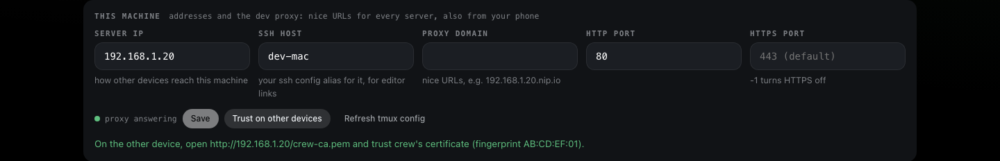
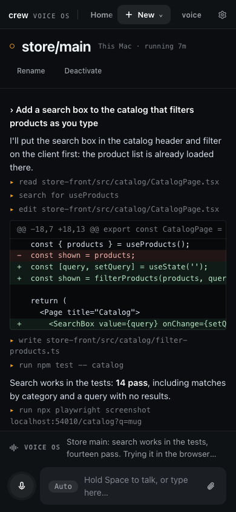
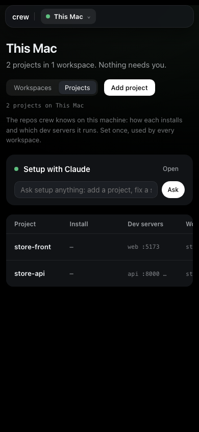
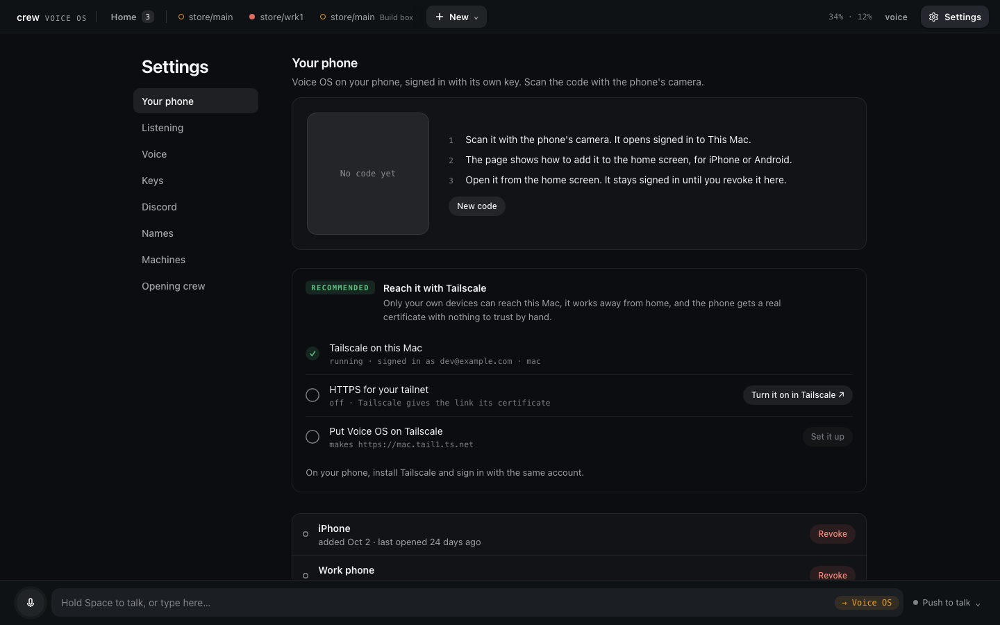
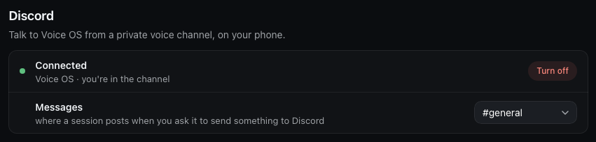

# From anywhere

crew's page lives on the machine that runs crew's server, and out of the box only that machine's
browser opens it, at a `localhost` link. That's fine at the desk. This tutorial is about the rest:
the page on another computer, on my phone, and Voice OS in a Discord voice channel, which is how I
talk to my sessions when I'm away from the desk.

It builds on [the first two tutorials](1-install-and-first-worktree.md), and works the same whether
the server runs on your laptop or on a VM. The details are in
[Other devices](../concepts.md#other-devices), [Settings](../guides/setup.md#settings) and the
[Voice OS guide](../guides/voice-os.md).

## Two ways in

There are two ways to reach the page from somewhere else. **crew's proxy** gives it a real hostname
on your network that any device can open. An **SSH tunnel** forwards the page's port to the
computer you're on, so it opens as `localhost` there. The proxy is the one for a phone. The tunnel
is the quick one from another computer that already has SSH.

The microphone matters for choosing. Browsers give it only to `localhost` and HTTPS pages. A tunnel
is `localhost`, so voice works at once. The proxy needs HTTPS, which crew serves with its own
certificate, and each device has to trust that once. Until it does, the proxy link works for typing
and clicking but not for voice.

## crew's proxy

crew's server starts the proxy and puts the page on it at `voice--os.<domain>`. You set it up in
**Set up** → **Settings** (it's in the machine picker), in the box called This machine.


Two fields decide where the page lives:

- **Server IP** is how other devices reach this machine. crew detects it from the first network
  interface. Change it when that's the wrong one, for example to put in the Tailscale address.
- **Proxy domain** is the name the links use. Left empty it's `<server IP>.nip.io`, a public DNS
  name that resolves to that IP with no setup. Put your own in when you have one, with a wildcard
  record (`*.dev.example.com`) pointing at the server IP.

Press **Save**. Next to it, the dot says **proxy answering** once the proxy is up. A changed domain
reaches the page's own link when crew's server starts again. Type `/restart` in any session's box in
Voice OS to do that. It ends the running sessions until they start again, so I do it when nothing is
mid-task.

On a Linux VM the proxy wants ports 80 and 443. If it can't have them, put other ones in **HTTP
port** and **HTTPS port**, like 8080 and 8443.

### Trust the certificate

Press **Trust on other devices**. The page answers with a line like "On the other device, open
http://…/crew-ca.pem and trust crew's certificate", with its fingerprint. On an iPhone you open that
link in Safari, install the profile, then turn it on under Settings → General → About → Certificate
Trust Settings. Android and other computers have their own certificate screens. Check that the
fingerprint the device shows matches the one on the page. You do this once per device.



### When it doesn't load

When a proxy link doesn't load on a phone, it's nearly always one of two things. If the page doesn't
load at all, the phone can't reach the machine (another network, guest Wi-Fi isolation, a VPN,
cellular). If `http://<server IP>/` loads but the hostname doesn't, the phone's DNS is refusing
`nip.io`, which routers with rebind protection and iOS Private Relay do. Allow `nip.io` there, or use
a domain of your own. [Tailscale](https://tailscale.com) sidesteps both: put the machine and the
phone on it, set **Server IP** to the Tailscale address, and the links work off your home network
too.

## An SSH tunnel

Over SSH, bare `crew` prints the proxy link when the proxy reaches the page. When it doesn't, it
prints the tunnel to run instead:

```
crew is running on this machine, port 51234. From your computer:
  ssh -L 51234:localhost:51234 store-vm
then open http://localhost:51234/login?token=…
```

Run the `ssh -L` line on the computer you're sitting at, leave it open, and open the link it gives.
The host in that line comes from **SSH host** in Settings. Without one it says `<this machine>` and
you put your own alias there.

## On a phone

The page fits a phone. Voice OS keeps the tabs in the top bar, and the session's stream takes the
screen with the spoken line and the input under it.



Set up works too. The toolbar and Setup with Claude stack, and tables scroll sideways.



The page wants a sign-in the first time a browser opens it, and that link is the one thing the page
can't hand you. On the machine, `crew server status` prints it, the localhost one and the proxy one.
Open the proxy link on the phone once, after trusting the certificate, and it stays signed in.

Push to talk is the most reliable listening mode on a phone, because phones pause the microphone
when the tab goes to the background or the screen locks. That's the main reason I use Discord when
I'm out.

## Voice OS in Discord

With Discord set up, a bot of your own joins one voice channel of one Discord server while Voice OS
runs. You join that channel from the Discord app on your phone and talk, and Voice OS answers in the
channel. It only takes your voice, anyone else in the channel is ignored. It needs no certificate
and no open tab, and it keeps going with the screen off.

Voice OS's **Settings** (the gear at the top right) has a **Discord** section. Until it's set up it
says **Not set up** and lists the steps.



### Make the server and the bot

These are all in Discord.

1. Make a Discord server of your own, private, with a voice channel. A channel named **Voice OS**
   is picked first. Otherwise crew takes the only voice channel, or asks.
2. Open the [Discord Developer Portal](https://discord.com/developers/applications), create an
   application, open **Bot**, and press **Reset Token** to get the bot's token. Keep it for the next
   step. The bot needs no privileged intents, so you can leave those switches off.
3. Invite the bot to your server: **OAuth2** → **URL Generator**, tick the `bot` scope, and the
   permissions **View Channel**, **Connect** and **Speak**. Add **Send Messages** and **Attach
   Files** if you want sessions to post to a text channel (below). Open the generated URL and pick
   your server.

### Hand crew the token

The token is a secret, so the page never asks for it. Paste it in a terminal on the main instead:

```bash
crew server discord setup
```

It asks for the token and hides what you paste. crew checks it with Discord first, and a rejected
token saves nothing. Then it picks the server (the only one the bot is in), whose voice to take (the
server's owner, which is you) and the channel, and checks the bot may View Channel, Connect and Speak
there. When it can't decide, it lists the options and says what to run again. The running Voice OS
picks it up on its own, no restart.

### Join the channel

Open Discord, join the voice channel, and talk. Settings' Discord section now shows whether the bot
is connected and whether you're in the channel.



While you're in the channel, Discord is the microphone. Only two listening modes mean anything
there: on demand, where only what follows "Voice OS" is taken, and hands-free, where every turn is
acted on. Pick one from the menu by the mic on the page, or say it. Any open tab still shows the
conversation and takes typing.

**Turn off** leaves Discord and removes the token. It asks first, and **Keep it** backs out.
Clicking **voice** in the top bar to turn voice off takes the bot out of its channel too, until you
turn voice on again.

### Sending things there

Sessions can post to Discord when you ask them to: "send that screenshot to Discord", "post the
summary in Discord". It works for sessions on the main and on any remote, and the main posts it with
the bot. Up to 10 files of 10 MB each go in one message, and mentions in it never ping anyone.

Messages go to the voice channel's own chat. To use a text channel instead, pick it under
**Messages** in the Discord section.

That's the whole tour. From here, [Voice OS commands](../guides/voice-os-commands.md) lists
everything you can say. Everything on these pages is also a crew command, listed in
[every command](../commands.md).
