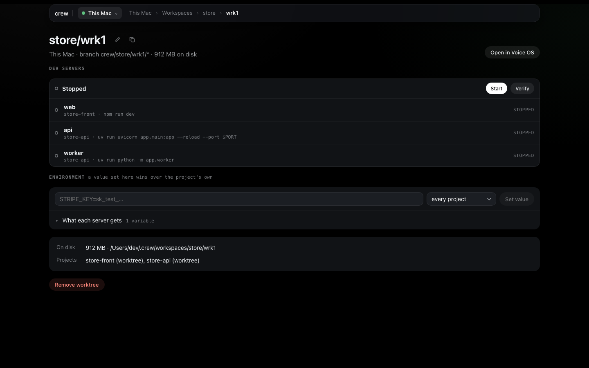
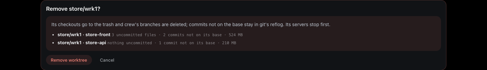
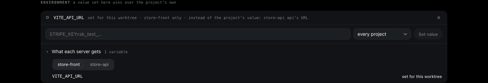
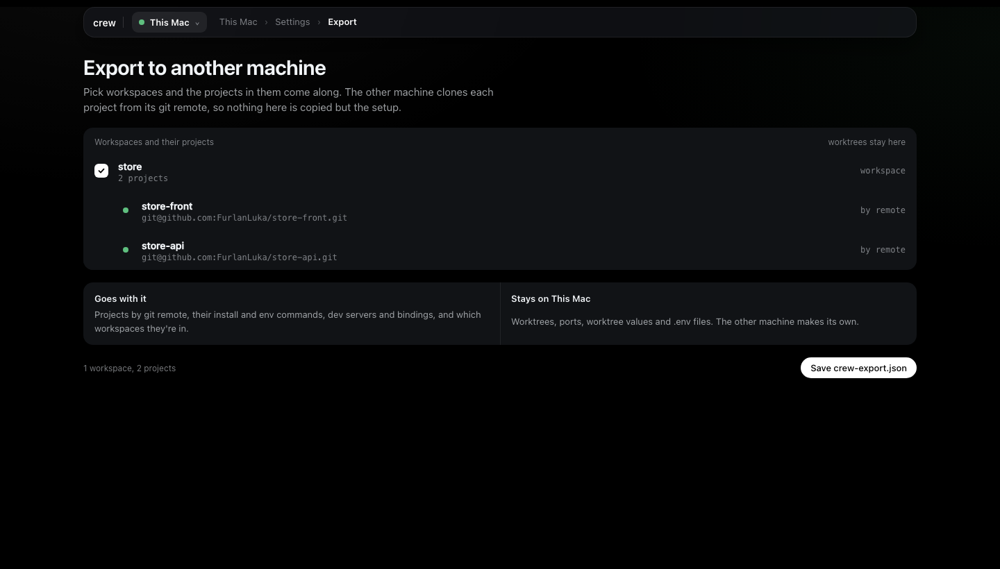
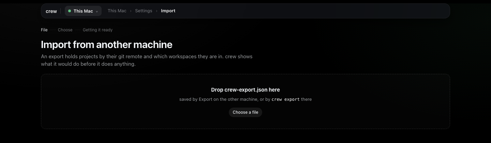
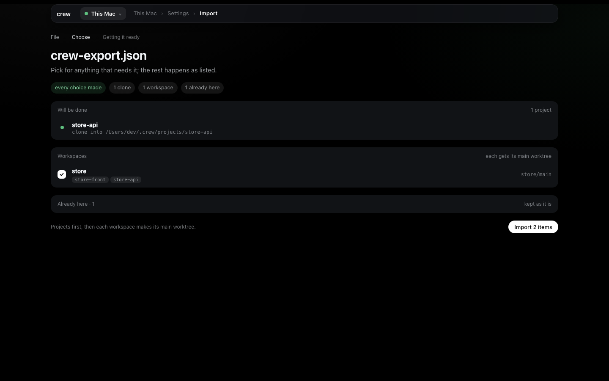
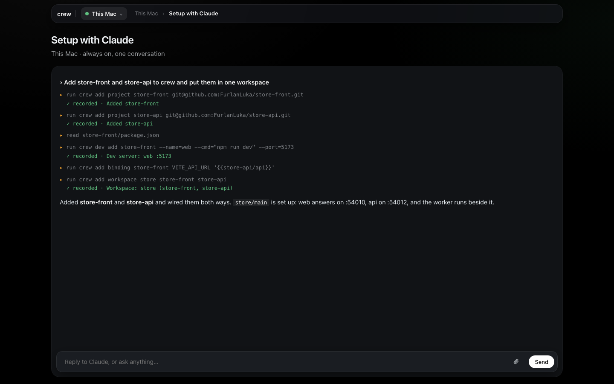

# Everyday work and keeping things tidy

By now you have a workspace, a couple of worktrees and probably Voice OS. This is the rest of what
I do day to day in Set up, one short section each. It's the `store` workspace from
[tutorial 1](1-install-and-first-worktree.md) again, with `store/main` and `store/wrk1`.
[Set up](../guides/setup.md) describes every page in full.

## Worktrees

A new worktree is a fresh copy of every project in the workspace, on its own branches and ports.
**+ new** on the workspace's row on the board, or **New worktree** on the workspace's page, opens
the form:

**Start from** shows each project's base branch and how far it is behind origin. **pull first**
fast-forwards those bases before branching, and it never touches a branch you have checked out.
**Create worktree** takes me to the new worktree's page, where the Dev servers card follows each
project through checkout, install and its servers coming up.

The worktree's page has two small icons beside its name, **Rename** and **Duplicate**:

**Duplicate** asks for a name and makes fresh checkouts of the same projects on new ports, with
the values set for this worktree copied across (more on those [below](#a-value-for-one-worktree)).

Once I know what a worktree is for, I give it a name that says so. **Rename** moves its checkouts
and renames crew's branches, so `crew/store/wrk2/store-api` becomes
`crew/store/search-fix/store-api`. Its ports, its values and any recorded failure go with it. It's
refused while the worktree's servers run or setup is busy with it, so press **Stop** first. A
branch you already pushed keeps its old name on the remote, and an editor or shell you had open on
the old folder still points there.

**Remove worktree** at the bottom of the page doesn't remove anything straight away. It first shows
what each checkout would lose: uncommitted files, commits that aren't on the base branch, and its
size on disk. Confirming stops its servers, moves the checkouts to crew's trash (deleted in the
background, see [Settings](#settings)) and deletes crew's branches. Commits that weren't on the base
stay in git's reflog if you need them back. Removing a workspace's last worktree removes the
workspace too, and the confirm says so.

## A value for one worktree

The Environment on a project's form computes a value for every worktree. Sometimes one worktree
needs something else: a copy that should talk to a shared staging API, or a test key only one copy
needs. That's the **Environment** card on the worktree's page. I type `VITE_API_URL=https://staging.example.com`,
pick **store-front** instead of **every project** in the menu beside it, and press **Set value**.

The line then says **set for this worktree** and what it replaces, like "instead of store-front's
value: store-api api's URL". A value set here wins over the project's own Environment, including
lines for one server. **What each server gets** shows the final set, and **×** on the line takes it
away. Servers read the new value on their next start, so press **Restart** after.

## A binding for one server

A line in a project's Environment reaches every server of that project. **For** picks one server
instead, which is how a monorepo's web app and its worker get different values. On store-api's
**Edit setup** I add `STORE_URL` from **store-front's URL** with **For** set to **worker only**.
The preview under it shows what the worker would get in each worktree, marked "worker only":

On the worker, that line wins over a project-wide line of the same variable. Saved, it shows as
"worker only" in the list, and **What each server gets** on a worktree page shows it under the
worker. [How crew works](../concepts.md#bindings) has the precedence spelled out.

## Checking a project from nothing

When I change a project's install, env command or servers, I want to know that a clean checkout
still comes up, without touching any worktree I work in. **Check** on the project's page (or on
its row in the board's **Projects** tab) does exactly that: a scratch checkout of its own, the
install, the env command, and every dev server has to answer. **Save and check** on the form runs
the same check after saving.

The check page follows it step by step. A pass is a green line on the project and the scratch
checkout is cleared away. A failure stays on the project's page with the step it stopped at and
the end of its log, with **Fix with Claude**, **Edit setup**, **Check again** and **Full log** under
it, and shows up in the board's problems strip until it passes.

## Moving to another machine

Settings has **Export…** and **Import…**. Export is its own page: I tick workspaces and their
projects come along, and the page says what goes with the file (projects by git remote, their
install and env commands, dev servers and bindings, and which workspaces they're in) and what stays
(worktrees, ports, worktree values and `.env` files). **Save crew-export.json** downloads it.

On the other machine, **Import…** (or **Import** on the very first run) takes the file. Drop it
or **Choose a file**:

Then it shows the plan with every choice up front, before it does anything. **Will be done** is the
clones. **Needs a choice** is anything crew can't decide alone, like a project with no remote
(**Point at a folder** or **Skip**) or a name already taken by a different repo here
(**Import as store-api-2**, **Replace mine** or **Skip**). **Already here** is folded away. Each
workspace is made with its `main` worktree. **Import** stays off until every choice is made, then
runs it all and ends on **Open Voice OS** or **Go to the board**.

## Settings

Settings is in the machine picker's menu at the top left.

When a newer crew is out, the top row says so with **Update**. crew's server keeps running the old
version until you restart it. Machines you've added are updated from the main after: when a remote
runs an older crew than the main, the main updates it, once per version, and never downgrades one.

**This machine** holds its addresses and crew's proxy. By default everything is on
`localhost`. With a **Server IP** and a **Proxy domain** set, other devices on your network reach
crew's page through the proxy by name, a phone included, and the line under the fields says whether
the proxy answers. **Trust on other devices** shows how to trust crew's certificate on a Mac, iPhone or
Android, once per device, which the phone needs for the microphone in Voice OS.
[Other devices](../concepts.md#other-devices) explains why.

**Disk** is where removed things go. **Trash** is removed checkouts waiting to be deleted, because a
checkout with a full build in it can be huge; crew empties it in the background and **Empty now**
does it now. **Left behind** is what crew can clear on its own: old failed checks, logs of removed
worktrees, stale locks. crew sweeps those at most hourly, and **Clean up** runs it now. Both say what
they'll remove before they do.

## When you don't know where to click

Setup with Claude is the box at the top of the board, and **Open** shows the whole conversation.
It's a Claude Code session in your home folder that drives crew for you, so I ask it anything I'd
otherwise hunt for in the forms: "add the signals repo to crew and give it a worktree", "why does
store-api's install fail?", "check this machine".

Each step it takes shows up as it goes, and every change it actually recorded gets a green
**✓ recorded** line, taken from what crew did and not from what Claude says about it. Type **@** in
the box to name one of this machine's worktrees or projects. **Fix with Claude** and **Ask Claude**
anywhere in Set up start here, with the failure or the form already said.

Everything in this tutorial is also a crew command, for scripts and agents:
[the command reference](../commands.md) has them all.
